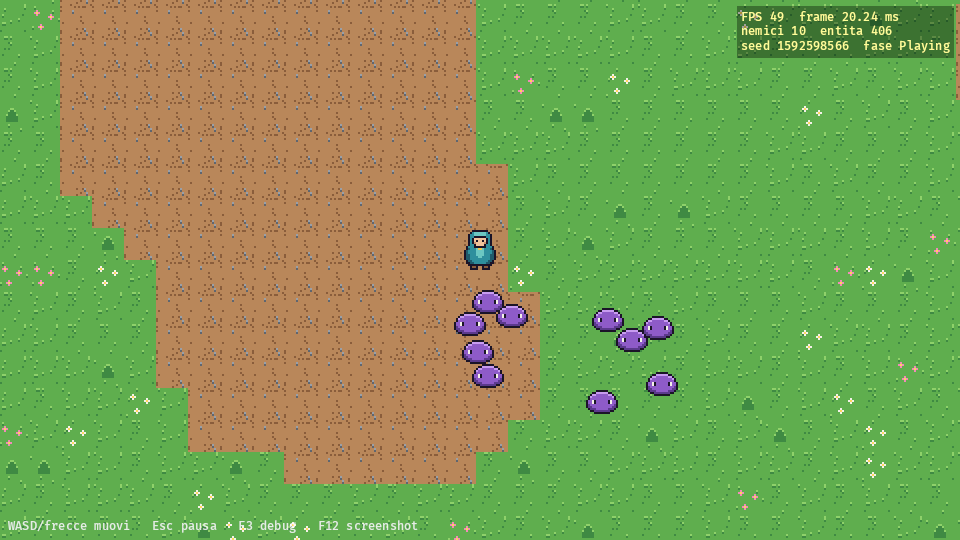

# Pixel Monster Survivor (nome provvisorio)

Survivor roguelite top-down 2D in pixel art: un evocatore e i suoi compagni mostriciattolo
originali contro orde di creature. Rust + Bevy 0.20, desktop Windows ora, web (WASM) dalla P1.

**Stato:** Phase S0 completata. Arena procedurale, movimento 8 direzioni, camera
pixel-perfect, 10 nemici che inseguono. Prossimo passo: P0 (compagni, attacchi, XP, boss).
Dettagli in [docs/PROGRESS.md](docs/PROGRESS.md).



## Requisiti (Windows)

- Rust via rustup: la versione giusta (1.99.1) si installa da sola grazie a `rust-toolchain.toml`.
- Visual Studio Build Tools 2022 con il workload "Sviluppo di applicazioni desktop C++".
- Python 3 + Pillow, solo per rigenerare e validare gli asset.

La prima compilazione scarica e compila Bevy: ~23 minuti e ~10 GB in `target/` su un
Core Ultra 5. Le successive richiedono 30–60 s.

## Comandi

```bash
cargo run
```

```bash
cargo run -- --autoplay --overlay --screenshot screenshots/prova.png --screenshot-after 4 --exit-after 5
```

```powershell
./scripts/check.ps1
```

```bash
python scripts/build-assets.py
```

Per cambiare i valori di gioco (velocità, danni, nemici, compagni) modifica i file in
`game-data/`. Con questo comando il gioco li ricarica appena salvi e la run riparte:

```bash
cargo run
```

Se un valore non è valido il gioco mostra l'elenco degli errori con file e campo.

| Tasto | Azione |
|---|---|
| WASD / frecce | movimento |
| Esc / P | pausa |
| F5 | ricomincia la run |
| F3 | overlay debug (FPS, entità, posizione, seed) |
| F12 | screenshot in `screenshots/` |

Opzioni: `cargo run -- --help`.

## Struttura

```text
src/            codice (app, gameplay, world, presentation, diagnostics)
tests/          simulazione headless senza GPU
assets-src/     sorgenti testuali della pixel art + palette
assets/         PNG generati + manifest (non modificare a mano)
scripts/        check, generazione e validazione asset, verifica griglia pixel
docs/           GDD, architettura, art bible, backlog, decisioni, progressi, QA, prove
.claude/agents/ ruoli degli agenti specializzati (vedi AGENTS.md)
```

Regole per gli agenti IA: [AGENTS.md](AGENTS.md). Licenze degli asset:
[ASSET_LICENSES.md](ASSET_LICENSES.md). Specifica completa:
[HANDOFF_PIXEL_MONSTER_SURVIVOR.md](HANDOFF_PIXEL_MONSTER_SURVIVOR.md).
